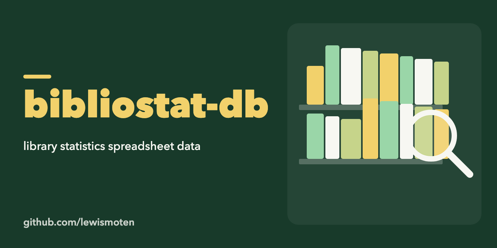

# bibliostat-db

A small Node.js script that reads a spreadsheet of the Virginia Public Library Survey (an `.xlsx` file) and prints the first sheet as rows of data.

## Status

Early start from October 2025. It only reads one workbook and logs it; there is no database yet.

## Use

```sh
npm install
npm start
```

Edit the `file` path at the top of `index.js` to point at your copy of the survey workbook first. It uses the [xlsx](https://www.npmjs.com/package/xlsx) package.

## License

ISC. See [LICENSE.md](LICENSE.md).
